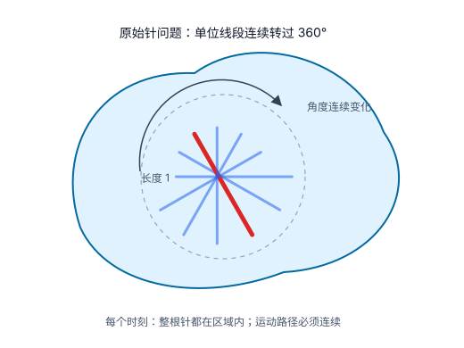
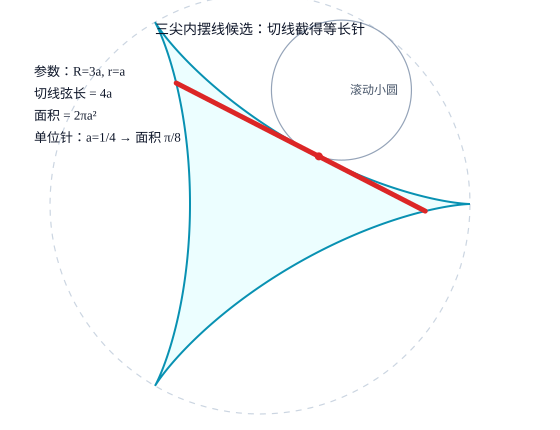
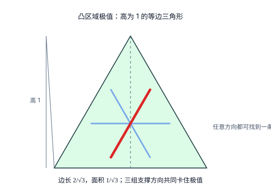
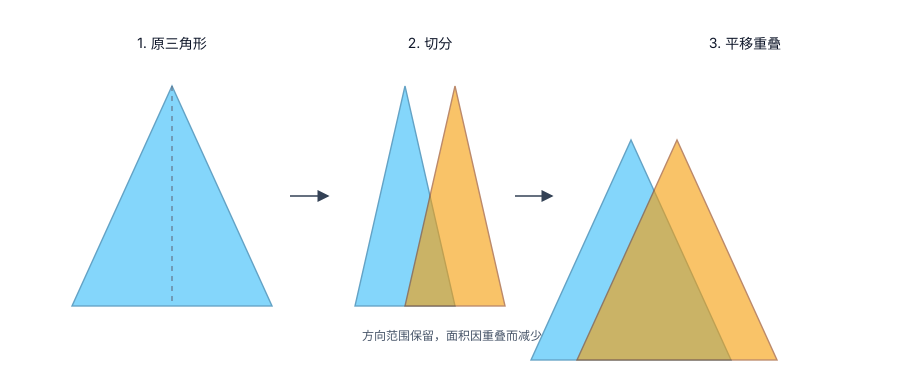
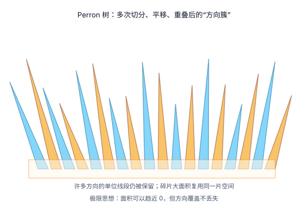
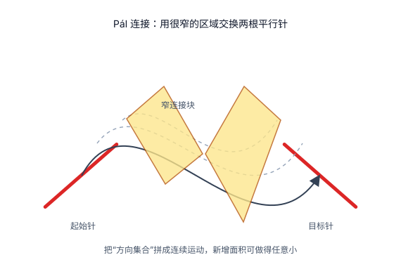
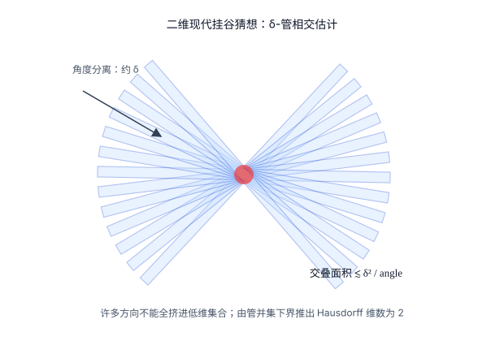

# 一根针怎样把“面积直觉”彻底打碎

> 读者预备知识：学过大一高等数学即可。你需要知道三角函数、导数、定积分、面积公式，以及“极限”是什么意思。文中出现的集合论术语都会先用直观语言解释。  
> 本文先不急着说这个问题的正式名字。我们只从一个人人都能想象的小游戏开始：一根长度为 1 的针，怎样在尽可能小的平面区域里转过所有方向？

## 0. 先把问题说清楚

想象桌面上有一根长度为 1 的细针。你要在桌面上画一个区域，让这根针在区域内部转一整圈。转动过程中，针不能有任何一部分伸到区域外。

问题是：

**这样的区域，面积最小可以是多少？**

这个问题最迷人的地方在于，它一开始看起来像普通几何题，最后却会告诉我们：面积、复杂度、方向信息其实不是一回事。

为了不混乱，我们先分清两个版本。

1. **古典转针问题**：针要真的连续运动。也就是说，针的位置和角度都要平滑或至少连续地变化，不能瞬移。
2. **方向集合问题**：不管运动过程，只要求对每个方向，都能在集合中找到一条长度为 1 的线段。

第二个版本看起来弱一些，因为它不用安排针如何从一个方向走到另一个方向。但它抓住了问题的核心：**所有方向都必须出现**。

本文会按历史顺序讲四件事。

1. 最初为什么很多人猜三尖内摆线是答案。
2. 如果区域必须凸，为什么答案是高为 1 的等边三角形。
3. Besicovitch 如何用 Perron 树把面积压到任意小。
4. 为什么面积可以是 0，但它的“维数”仍然必须是 2。

## 1. 原始几何题：单位针、所有方向、连续运动

把一根针看成一条线段。长度固定为 1。

如果针的方向与 \(x\) 轴夹角为 \(\theta\)，那么一根方向为 \(\theta\) 的单位线段可以写成

\[
(x,y)+t(\cos\theta,\sin\theta),\qquad -\frac12\le t\le \frac12.
\]

这条公式的意思很朴素：

1. \((x,y)\) 是针的中心。
2. \((\cos\theta,\sin\theta)\) 是针指向的方向。
3. \(t\) 从 \(-1/2\) 走到 \(1/2\)，刚好扫出长度为 1 的线段。

所以“区域 \(K\) 能容纳所有方向的针”可以翻译成：

**对每个角度 \(\theta\)，都存在某个中心点 \((x,y)\)，使上面整条线段都落在 \(K\) 里面。**

如果还要求针能连续旋转，就要再加一句：\((x,y)\) 和 \(\theta\) 必须能随时间连续变化。

这个翻译很重要。它把一个看似物理的转动问题，变成了一个关于线段、方向和面积的数学问题。

## 2. 第一阶段：三尖内摆线为什么看起来像答案

1917 年，这个转针问题被正式提出后，一个非常自然的猜测是：

**最小区域应该是某个漂亮、对称、刚好包住转针轨迹的图形。**

经典候选就是三尖内摆线，也叫 deltoid。

三尖内摆线可以这样生成：让一个小圆在一个大圆内部滚动，小圆上的一点画出的轨迹就是三尖内摆线。

单位针版本中，正确的尺度是：

1. 小圆半径 \(a=1/4\)。
2. 大圆半径 \(3a=3/4\)。
3. 三尖内摆线的面积是 \(\pi/8\)。

### 证明过程 A：三尖内摆线为什么能让针转一圈

取一般尺度 \(a\)。三尖内摆线的一种参数方程是

\[
x(t)=2a\cos t+a\cos2t,\qquad
y(t)=2a\sin t-a\sin2t.
\]

这里的 \(t\) 可以理解为小圆滚动时的参数。随着 \(t\) 从 \(0\) 到 \(2\pi\)，点 \((x(t),y(t))\) 画出整个三尖内摆线。

接下来用大一高数里的“切线”思想。对参数方程求导：

\[
x'(t)=-2a\sin t-2a\sin2t,
\]

\[
y'(t)=2a\cos t-2a\cos2t.
\]

导数向量 \((x'(t),y'(t))\) 给出曲线在该点的切线方向。

三尖内摆线有一个关键性质：

**任取一条非尖点处的切线，它截在三尖内摆线内部的那段弦长恒等于 \(4a\)。**

也就是说，如果把针放在这条切线弦上，针的长度就是 \(4a\)。当切点沿曲线连续移动时，切线也连续转动，弦就像一根针一样转过所有方向。

因此只要令

\[
4a=1,
\]

就得到

\[
a=\frac14.
\]

这时每条切线弦刚好是一根单位针。

高数读者可以把这里的验证理解成三步计算：

1. 写出切线方程。
2. 求这条切线与三尖内摆线的两个交点。
3. 用两点距离公式算出交点间距离，结果恒为 \(4a\)。

完整代数会比较长，但只用到参数方程、导数、三角恒等式和距离公式。

### 证明过程 B：三尖内摆线面积为什么是 \(\pi/8\)

这里用一个常见的参数曲线面积公式：

\[
A=\frac12\int_0^{2\pi}(x(t)y'(t)-y(t)x'(t))\,dt.
\]

这个公式可以看作 Green 公式的一个特殊情形；如果还没学过 Green 公式，也可以把它当成“参数曲线围成面积”的标准公式。

把

\[
x(t)=2a\cos t+a\cos2t,\qquad
y(t)=2a\sin t-a\sin2t
\]

代入面积公式，整理三角函数后得到

\[
A=2\pi a^2.
\]

单位针要求 \(a=1/4\)，所以

\[
A=2\pi\left(\frac14\right)^2=\frac{\pi}{8}\approx0.3927.
\]

这就是三尖内摆线猜想的魅力：图形好看，针确实能转，面积还能精确算出来。

### 一个常见尺度误差

有时会看到“小圆半径 \(1/3\)、大圆半径 \(1\)”的说法。这个说法描述的确实也是三尖内摆线，但不是单位针的尺度。

因为此时 \(a=1/3\)，切线弦长是

\[
4a=\frac43,
\]

不是 1。面积也变成

\[
2\pi\left(\frac13\right)^2=\frac{2\pi}{9}.
\]

所以单位针对应的是小圆 \(1/4\)、大圆 \(3/4\)，面积 \(\pi/8\)。

## 3. 第二阶段：如果必须是凸图形，答案反而更大

“凸图形”就是没有凹进去的地方。更准确地说，图形中任意两点连成的线段，都仍然在图形内部。圆、椭圆、三角形、矩形都是凸的；月牙形、星形通常不是凸的。

如果要求转针区域必须是凸的，三尖内摆线就不合格，因为它有三个向内弯的凹口。

这时 Pál 在 1921 年证明：

**所有凸区域中，面积最小的是高为 1 的等边三角形。**

### 证明过程 A：高为 1 的等边三角形为什么可行

先算它的面积。

等边三角形边长为 \(s\)，高为

\[
\frac{\sqrt3}{2}s.
\]

令高等于 1，就有

\[
\frac{\sqrt3}{2}s=1,
\]

所以

\[
s=\frac{2}{\sqrt3}.
\]

面积是

\[
A=\frac12\times\text{底边}\times\text{高}
=\frac12\cdot\frac{2}{\sqrt3}\cdot1
=\frac1{\sqrt3}\approx0.577.
\]

接下来说明为什么它能容纳所有方向的单位针。

对某个方向 \(\theta\)，在三角形内部看所有平行于 \(\theta\) 的弦。随着平行线平移，弦长从 0 逐渐变大，再逐渐变回 0。最长的一条弦至少能达到 1。

最容易“卡住”的方向是垂直于某条边的方向，这时最长弦正好是一条高，长度为 1。其他方向会斜着穿过三角形，最长弦不会比这条高更短。因此每个方向都能找到长度至少为 1 的线段。

所以高为 1 的等边三角形是一个合法的凸转针区域。

### 证明过程 B：为什么凸区域不能更小

完整证明属于凸几何，但核心想法可以用大一水平理解。

设 \(K\) 是一个能容纳所有方向单位针的凸区域。

对每个方向，我们不只看“有没有一根针”，还看这个方向上 \(K\) 能切出的最长弦。因为 \(K\) 能放下一根单位针，所以每个方向的最长弦都至少为 1。

这给了 \(K\) 很强的限制：

1. 你不能只在某几个方向留空间。
2. 你也不能把空间切碎，因为凸性会自动把碎片中间的空隙补起来。
3. 任何方向都必须有一条足够长的直线截段。

凸性是关键。非凸图形可以把许多细碎部分错开、重叠；凸图形一旦包含两块远离的区域，中间整段也必须包含，于是面积很难压缩。

Pál 的下界证明可以概括成这样：

1. 如果一个凸区域是最小的，那么它的边界不能有“没用到”的部分。否则可以切掉一点面积，而不影响任何方向的单位弦。
2. 这些不能切掉的边界由若干支撑线决定。支撑线可以理解为刚好碰到凸图形边界、但不切进图形内部的直线。
3. 在平面里，要同时卡住所有方向，最经济的支撑结构由三组方向组成，而且三组方向相隔 \(120^\circ\)。
4. 这三组支撑线围出的最小图形正是高为 1 的等边三角形。

于是得到严格结论：

\[
|K|\ge\frac1{\sqrt3}.
\]

等号由高为 1 的等边三角形取到。

这个结果非常有启发性：在凸世界里，面积有一个明确的正下界；而且这个下界比三尖内摆线的 \(\pi/8\) 还大。说明想继续压缩面积，必须利用非凸性。

## 4. 第三阶段：Besicovitch 的反直觉突破

1928 年，Besicovitch 给出了真正惊人的结论：

**对任何你给定的正数 \(\varepsilon\)，哪怕它小到 \(0.000001\)，也能构造一个包含所有方向单位线段的集合，使它的面积小于 \(\varepsilon\)。**

用公式写就是：

\[
\forall \varepsilon>0,\quad
\exists E,\quad
E\text{ 含有每个方向的一条单位线段，并且 }|E|<\varepsilon.
\]

这里 \(|E|\) 表示面积。

更进一步，还可以构造面积为 0 的集合，仍然包含每个方向的单位线段。所谓“面积为 0”，不是说集合不存在，而是说它薄到用普通面积去量时量不出来。比如一条线段长度可以是 1，但平面面积是 0。

Besicovitch 的集合比线段复杂得多：它包含所有方向的单位线段，但面积仍然可以为 0。

### 核心想法：方向不用各占一块地方

最初的直觉是：

**针有很多方向，所以每个方向都要占一块地方，总面积应该不小。**

Besicovitch 的想法反过来：

**许多方向的线段可以大量重叠，共用同一片区域。**

这就像把许多透明胶片叠在一起。每张胶片上都有一条方向略不同的线，单独看方向很多；但叠起来以后，它们占用的桌面面积可以很小。

几何上实现这个想法的工具叫 Perron 树。

### 证明过程 A：一次 Perron 操作

先取一个三角形。把顶点到底边上任一点的线段都画出来。随着底边上的点移动，这些线段的方向连续变化，所以这个三角形其实保存了一整段方向。

现在做一次操作。

**第一步：切分底边。**  
把底边分成很多小段。每一小段和顶点连起来，形成一个细三角形。每个细三角形只负责一个很小的方向范围。

**第二步：平移细三角形。**  
把这些细三角形沿水平方向移动。平移不会改变线段的方向，所以它们负责的方向范围仍然保留。

**第三步：让它们重叠。**  
通过合适的平移，可以让很多细三角形挤在一起。它们依旧覆盖原来的方向范围，但并集面积变小了。

这个过程看起来像作弊，但没有违反规则：线段的方向没有丢，长度也没有变，只是不同方向的线段开始共用空间。

### 证明过程 B：为什么迭代后面积能趋近 0

一次重叠只能省一点面积。Besicovitch 的厉害之处在于把这个动作重复很多次。

可以把逻辑写成这样。

第 1 轮：把大三角形切成许多细三角形，让它们重叠，面积减少。  
第 2 轮：对每个细三角形再切分，再平移，再重叠，面积继续减少。  
第 3 轮：继续重复。  
一直做下去。

每一轮都保留方向覆盖，因为切分和平移不会删除方向，只是把负责方向的小块换了位置。

同时，每一轮都能安排出大量重叠，使得剩余面积乘上一个小于 1 的比例。粗略地说，如果每轮都把有效面积压成原来的 \(90\%\)，那么 \(n\) 轮后面积大约变成

\[
0.9^n.
\]

当 \(n\to\infty\)，有

\[
0.9^n\to0.
\]

真实构造里的比例和估计更复杂，但极限思想正是这个：**方向被保留，面积被反复压缩。**

这证明了：

\[
\text{面积没有正下界。}
\]

也就是说，三尖内摆线的 \(\pi/8\) 不是最小值；事实上没有最小正值。

## 5. 第四阶段：从“每个方向有线段”到“针真的能转”

到这里为止，我们已经有了一个面积任意小的集合，里面包含每个方向的单位线段。

但它还不是完整的古典答案。原因是：这些线段可能散落在不同位置。你知道每个方向都有一根针可以放进去，但不一定能把针从一个方向连续搬到另一个方向。

这时需要 Pál 的连接技巧。

### 证明过程：连接为什么也不用多少面积

假设我们有两根单位针 \(I_0\) 和 \(I_1\)，它们位置不同、方向也可能略有不同。我们想加一小片区域，让针能从 \(I_0\) 连续移动到 \(I_1\)。

直观方法是：

1. 让针沿一条很窄的通道平移。
2. 平移过程中，每次只旋转一个很小角度。
3. 把许多小旋转安排在重叠的窄区域中。

如果一次旋转角度很大，就会扫出比较大的扇形面积。可是如果把大旋转拆成很多次小旋转，每次只转一点点，再把这些小区域拉长、压窄、重叠，新增面积可以做得非常小。

高数里常见类似思想：把一个变化量分成很多小段，每段误差很小，总误差也可以控制。这里控制的是面积。

于是可以这样完成古典转针问题：

1. 用 Perron 树做出一个面积很小的方向覆盖集合。
2. 按方向顺序把这些线段排成有限多个方向块。
3. 在相邻方向块之间加入很窄的连接区域。
4. Perron 树本身面积小于 \(\varepsilon/2\)，所有连接区域总面积也小于 \(\varepsilon/2\)。

于是总面积小于

\[
\varepsilon.
\]

最终得到：

\[
\forall\varepsilon>0,\quad
\exists K_\varepsilon,\quad
K_\varepsilon\text{ 允许单位针连续转一圈，并且 }|K_\varepsilon|<\varepsilon.
\]

所以古典转针问题的答案是：

**没有最小正面积；面积的下确界是 0。**

“下确界是 0”的意思是：面积可以无限接近 0，但不一定存在一个普通漂亮的最小图形刚好达到 0。

## 6. 第五阶段：面积为 0，不等于它只有一维

Besicovitch 的结果会让人产生一个新疑问：

既然面积能变成 0，那这个集合是不是本质上只像一条曲线？

现代方向集合理论的回答是：不是。

它说：

**平面中任何包含每个方向单位线段的集合，Hausdorff 维数必须是 2。**

Hausdorff 维数是高级概念，但直观上可以这样理解。

1. 点的维数是 0。
2. 光滑曲线的维数是 1。
3. 普通平面区域的维数是 2。
4. 分形可以有介于 1 和 2 之间的维数，比如 1.5。

二维方向集合的结论说：哪怕面积为 0，它仍然“复杂到二维”。它不是一条普通曲线，也不是维数 1.5 的薄分形，而必须达到维数 2。

这个结论由 Davies 在 1971 年证明。下面给出高数版证明思路。

### 证明过程 A：把线段加粗成小管

直接研究没有宽度的线段很难。我们先把每条单位线段加粗一点点。

令 \(\delta\) 是一个很小的正数，比如 \(0.01\)。把一条单位线段加粗成宽度为 \(\delta\) 的细长矩形。这个矩形常叫 \(\delta\)-管。

一根 \(\delta\)-管大约长 1、宽 \(\delta\)，所以面积大约是

\[
\delta.
\]

现在从所有方向里挑出大约

\[
N\sim\frac1\delta
\]

个方向，并让相邻方向至少相差 \(\delta\)。例如 \(\delta=0.01\) 时，可以挑出大约 100 个不同方向。

每个方向都有一根单位线段，把它加粗成 \(\delta\)-管。于是我们得到很多根细管。

所有细管面积直接相加，大约是

\[
N\delta\sim\frac1\delta\cdot\delta=1.
\]

如果它们完全不重叠，并集面积就大约是 1。但它们可以重叠，所以真实并集面积可能小很多。关键问题是：到底能小到什么程度？

### 证明过程 B：两根细管最多重叠多少

设两根细管的夹角是 \(\alpha\)。夹角越小，两根管越平行，重叠可能越长；夹角越大，交叉区域就越小。

几何估计给出：

\[
|T_i\cap T_j|\lesssim\frac{\delta^2}{\alpha}.
\]

这个公式可以这样理解：

1. 两根管宽度都是 \(\delta\)，所以交叉处横向尺度大约贡献一个 \(\delta^2\)。
2. 夹角 \(\alpha\) 越小，交叉区域被拉得越长，因此要除以 \(\alpha\)。
3. 符号 \(\lesssim\) 的意思是“不超过某个常数倍”，我们关心的是数量级。

现在方向是按 \(\delta\) 分开的，所以两根管的夹角至少像

\[
\delta,\;2\delta,\;3\delta,\ldots
\]

这样增长。

于是所有两两交叠面积加起来，大致会出现一个调和级数：

\[
\frac1{1}+\frac1{2}+\frac1{3}+\cdots+\frac1{N}.
\]

大一高数里知道，这个和大约像

\[
\log N.
\]

因为 \(N\sim1/\delta\)，所以总交叠规模最多带来一个

\[
\log\frac1\delta
\]

的因子。

### 证明过程 C：用“总量平方 / 重叠量”给并集下界

这里用一个常见不等式，可以把它理解成 Cauchy-Schwarz 的面积版本：

\[
\left|\bigcup_iT_i\right|
\ge
\frac{\left(\sum_i |T_i|\right)^2}{\sum_{i,j}|T_i\cap T_j|}.
\]

左边是很多细管合起来真正占了多少面积。右边告诉我们：如果单个面积总量不小，而两两重叠总量又没有大到离谱，那么并集面积就不能太小。

前面已经知道

\[
\sum_i|T_i|\sim1,
\]

而交叠总量最多带一个

\[
\log\frac1\delta.
\]

所以

\[
\left|\bigcup_iT_i\right|
\gtrsim
\frac1{\log(1/\delta)}.
\]

这不是一个固定正数下界，因为 \(\delta\to0\) 时它也会趋向 0。但它趋向 0 得非常慢，比任何正幂次都慢。

### 证明过程 D：为什么这推出维数必须是 2

现在解释“维数”的直观判据。

如果一个集合像一条曲线，给它加粗 \(\delta\)，面积大约像

\[
\delta.
\]

如果一个集合像维数 \(s\) 的对象，给它加粗 \(\delta\)，面积大约会像

\[
\delta^{2-s}.
\]

例如：

1. \(s=1\) 时，面积像 \(\delta^{1}\)，对应曲线。
2. \(s=1.5\) 时，面积像 \(\delta^{0.5}\)，比曲线厚一些，但还不到二维。
3. \(s=2\) 时，面积不再按正幂次快速变小，对应二维尺度。

假设这种方向集合的维数小于 2，比如 \(s=1.9\)。那么它的 \(\delta\)-加粗面积应该大约不超过

\[
\delta^{2-1.9}=\delta^{0.1}.
\]

但 Davies 型管估计告诉我们，它至少有

\[
\frac1{\log(1/\delta)}
\]

这么大。

当 \(\delta\) 非常小时，\(\delta^{0.1}\) 会比 \(1/\log(1/\delta)\) 小得多。例如正幂次下降很快，对数下降很慢。这就矛盾。

所以维数不能小于 2。平面中的维数最多也就是 2，因此它必须恰好是 2。

结论：

\[
\text{这种方向集合可以面积为 0，但 Hausdorff 维数必须为 2。}
\]

## 7. 现在揭晓：它叫挂谷问题

这个故事在数学上叫**挂谷针问题**，来自日本数学家挂谷宗一在 1917 年提出的问题。后来，人们把“每个方向都含有一条单位线段”的集合称为 Kakeya 集，或 Besicovitch 集。

如果只看问题本身，它像一个小游戏：一根针怎么转，最省地方？

但它真正留下来的，不是一个机械答案，而是一种反直觉的数学观念：

\[
\text{面积小，不等于信息少。}
\]

## 8. 一张时间线看全局

| 阶段 | 时间 | 人物 | 结论 | 高数版理解 |
|---|---:|---|---|---|
| 原始问题 | 1917 | 挂谷宗一 | 长度 1 的针要在平面区域里转过所有方向 | 把运动转成“每个角度都有一条单位线段” |
| 三尖内摆线候选 | 1910s-1920s | Kakeya | deltoid 可行，单位针面积为 \(\pi/8\) | 切线弦长恒为 1，面积用参数曲线积分算 |
| 凸区域最优 | 1921 | Pál | 凸类最小是高 1 等边三角形，面积 \(1/\sqrt3\) | 凸性不允许碎片化，支撑线把图形卡成三角形 |
| 面积任意小 | 1928 | Besicovitch | 含所有方向单位线段的集合可小于任意 \(\varepsilon\) | 切分、平移、重叠，方向保留而面积复用 |
| 连续转针补全 | 1920s 以后 | Pál/Besicovitch | 古典转针区域面积下确界为 0 | 用很窄的连接区域把线段族串起来 |
| 现代二维理论 | 1971 | Davies | 面积可为 0，但维数必须为 2 | 把线段加粗成细管，用交叠估计证明不能像低维集合 |

## 9. 它解决了什么，又启发了什么

如果面对普通听众，这一节可以这样讲：

**这个问题最初只是问“一根针转圈最少要多大地方”，最后却让数学家重新理解了三个概念：空间、方向和复杂度。**

### 它首先解决了一个很具体的问题

原始问题问的是最小面积。最后答案不是某个漂亮数字，而是一个更意外的结论：

\[
\text{没有最小正面积。}
\]

这句话的意思是：你给出任何一个正面积，不管多小，数学家都能构造出更小的转针区域。

它还顺手说明了一个很有教育意义的对比：

1. 如果区域必须是凸的，最优答案是高为 1 的等边三角形，面积是 \(1/\sqrt3\)。
2. 如果允许区域非常不规则、非凸、碎片化，面积可以任意小。

所以它解决的不只是一个几何题，而是告诉我们：**同一个问题，加不加“凸”这个条件，答案会从一个固定正数变成 0。**

这对数学很重要。因为很多现实问题也一样：约束条件一变，最优解的性质可能完全变掉。

### 证明方法带来的真实启发

Besicovitch 的构造像一个强力反例。它证明：

\[
\text{面积很小，并不说明方向信息很少。}
\]

更重要的是，这个反例不是一句口号。它带来了几种后来反复出现的数学方法。

**第一，反例法：先把直觉推到极限。**  
三尖内摆线告诉人们“也许存在一个最小图形”；Besicovitch 构造却说明“根本没有最小正面积”。这类反例在数学中非常有力量：它不是补充一个例子，而是直接告诉我们，某种看似合理的定理不可能成立。

这里解决的具体问题是：**如果不加凸性限制，原始最小面积问题没有正答案。**

**第二，切分与重叠：Perron 树成为一种原型。**  
Perron 树证明里最关键的动作是：

1. 把一大段方向切成许多小方向块。
2. 每个小块用一个细三角形表示。
3. 把这些细三角形平移，让它们尽量重叠。
4. 重复这个过程，让面积越来越小。

这不是比喻，而就是证明本身。它后来启发人们研究很多类似问题：当大量线段、细管、方向块同时存在时，它们到底能重叠到什么程度？

这类问题出现在组合几何中。例如，把方向离散成 \(N\) 个角度，问 \(N\) 根不同方向的细长矩形并在一起，面积至少多大。这个问题和前面 Davies 证明里的 \(\delta\)-管估计几乎是同一个骨架。

**第三，加粗线段：从“零面积集合”转成可估计对象。**  
线段本身没有宽度，很难直接算面积。Davies 的思路是把每条线段加粗成 \(\delta\)-管，再研究这些细管的并集面积。

这一步非常重要，因为它把抽象问题变成了一个高数读者能理解的问题：

\[
\text{很多细长矩形互相交叉，它们的总覆盖面积有多小？}
\]

于是原来“面积为 0 的怪集合”就变成了可计算的估计：

\[
|T_i\cap T_j|\lesssim\frac{\delta^2}{\alpha}.
\]

这个公式就是影响力所在：它把“方向差 \(\alpha\)”和“重叠面积”直接联系起来。方向越接近，重叠越大；方向越分开，重叠越小。

**第四，最大函数：沿所有方向看平均值。**  
在调和分析里，人们会研究这样的操作：给定一个函数 \(f(x,y)\)，沿很多方向的细长矩形取平均，然后问这些平均值最大能有多大。

这叫 Kakeya 最大函数。它和转针问题的关系非常直接：

1. 转针问题里有许多方向的细管。
2. 最大函数也沿许多方向的细管取平均。
3. 如果细管可以高度重叠，就会影响这些平均值能否被控制。

所以挂谷问题不是直接造出某种装置，而是给调和分析提出了一个核心警告：**多方向平均会遇到极端重叠现象，不能按普通面积直觉处理。**

**第五，波包图像：为什么它会碰到波和 PDE。**  
研究波动方程或 Fourier 分析时，一个复杂波可以被拆成许多“波包”。在几何图像上，每个波包常常像一根沿某个方向传播的细管。

这和 Davies 证明中的 \(\delta\)-管非常接近：

1. 线段方向对应波包传播方向。
2. 管的宽度对应尺度误差。
3. 管与管的重叠对应不同波包能量集中在同一位置。

所以它启发的不是“日常生活技巧”，而是一个具体数学问题：**许多方向传播的东西，能不能同时挤在很小的区域里？如果能，会挤到什么程度？**

### 如果要讲到现实，只能这样谨慎地讲

二维挂谷问题本身没有直接给出某个生活发明。更准确的说法是：

\[
\text{它提供了一种研究“多方向细长结构如何重叠”的数学模型。}
\]

这类模型和一些现实科学问题有相似数学语言，例如扫描成像、信号分析、波传播。相似点不是“针在转”，而是它们都会问：

1. 很多方向的信息怎样叠在一起？
2. 重叠会不会让信息不可区分？
3. 需要多少尺度上的观测，才能保证结构没有被“藏起来”？

这样讲才和证明有关：因为前面证明真正做的事，就是把方向离散化、把线段加粗成管、估计不同方向管之间的重叠。

### 最适合公众记住的一句话

所以这个故事最后可以这样收束：

\[
\boxed{\text{挂谷问题的意义，不是针本身，而是多方向结构能怎样重叠。}}
\]

## 参考资料

1. Soichi Kakeya, "Some problems on maxima and minima regarding ovals", Tohoku Science Reports, 1917.
2. Julius Pál, "Ein Minimumproblem für Ovale", Mathematische Annalen, 1921.
3. A. S. Besicovitch, "The Kakeya Problem", American Mathematical Monthly, 1963.
4. R. O. Davies, "Some remarks on the Kakeya problem", Mathematical Proceedings of the Cambridge Philosophical Society, 1971.
5. Eric W. Weisstein, [Kakeya Needle Problem, MathWorld](https://mathworld.wolfram.com/KakeyaNeedleProblem.html).
